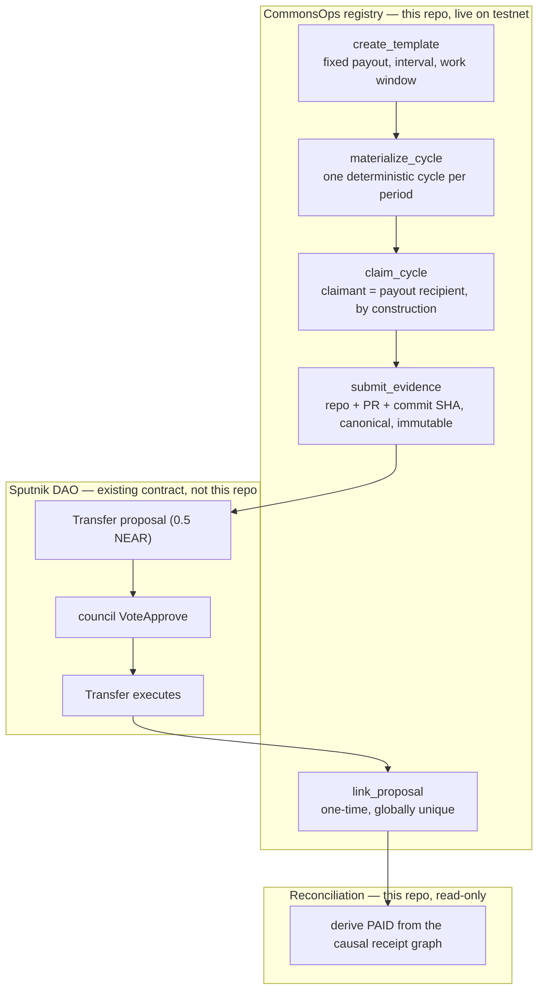
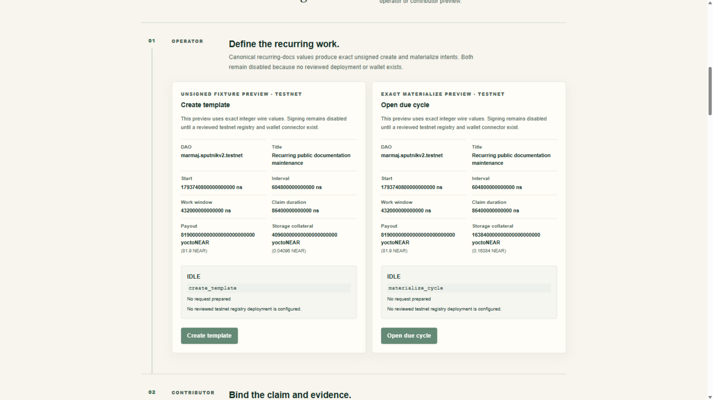
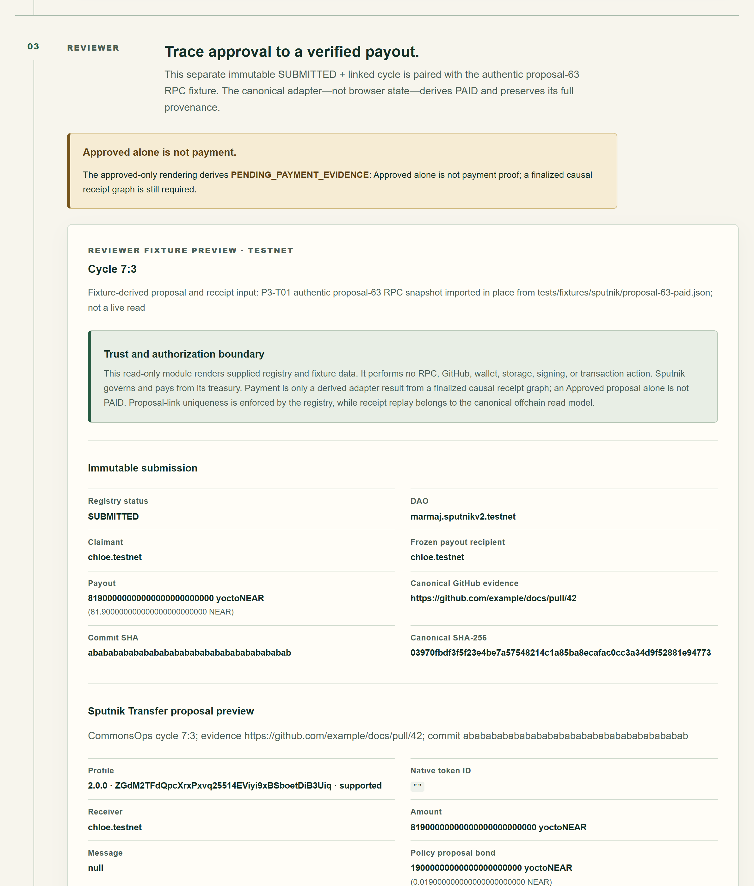
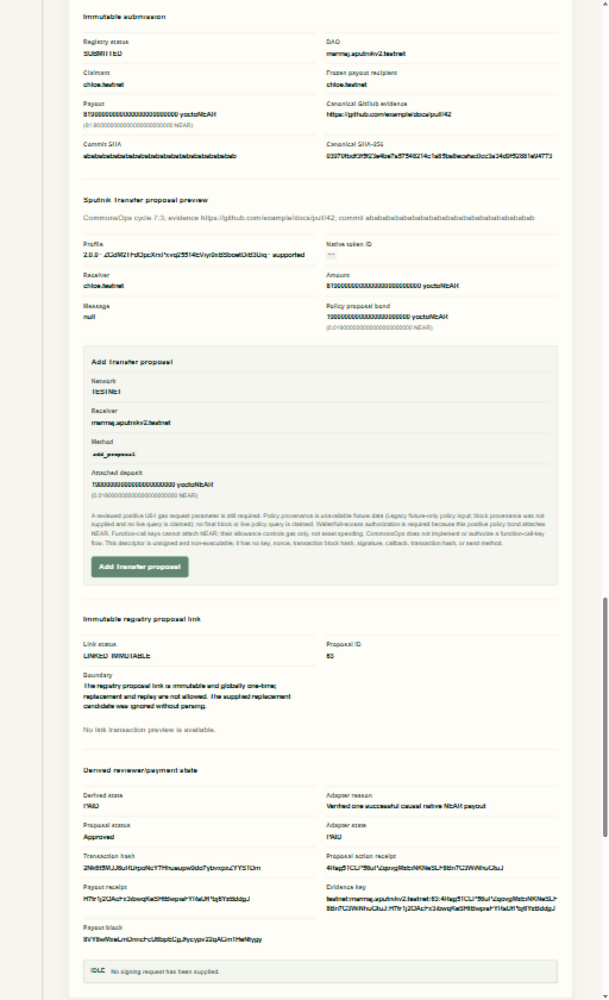

# CommonsOps

CommonsOps pays for recurring public work — like keeping documentation
maintained — with proof. A NEAR smart-contract registry tracks recurring work
cycles, binds a claimant to the payout recipient, freezes immutable evidence
of the work, and links one-time onchain to a Sputnik DAO proposal. Payment is
never assumed from an approval: a reconciliation layer derives **PAID** from
the finalized causal receipt graph of the real DAO transfer.

The registry is **live on NEAR testnet**, and a complete work cycle — claim,
evidence, DAO approval, payout, onchain link, and PAID reconciliation — has
been executed and independently reviewed. This repository contains the
contract, the reconciliation tooling, a truthful web workspace, and the public
evidence for all of it.

- **Track:** Social Money (`social`)
- **Network:** NEAR testnet only (no mainnet deployment)
- **License:** [MIT](LICENSE)

## In one minute

- **Problem.** Community maintenance work is recurring and easy to promise
  but hard to prove. Treasuries pay without verification; approval and
  payment get conflated.
- **Idea.** Make each work cycle a first-class onchain object: one claimant
  bound to the payout recipient, immutable evidence, a one-time link to a
  Sputnik DAO transfer proposal — and a payment state that is _derived_ from
  the chain, not _assumed_ from a vote.
- **What you will see.** Exactly three observable outcomes:

  | Outcome                    | Meaning                                                                                                                                        |
  | -------------------------- | ---------------------------------------------------------------------------------------------------------------------------------------------- |
  | `PAID`                     | The finalized causal receipt graph of the real DAO transfer matches the cycle exactly (amount, recipient, direct child of the approval action) |
  | `PENDING_PAYMENT_EVIDENCE` | The proposal was approved, but no verified payout receipt exists — approval alone is not payment                                               |
  | Onchain rejection          | Duplicate claims and proposal-reuse attempts fail at the contract with no state change (demonstrated live, see below)                          |

## Contents

- [In one minute](#in-one-minute)
- [How it works](#how-it-works)
- [See it](#see-it)
- [Explore without running anything](#explore-without-running-anything)
- [Run it yourself — do X, see Y](#run-it-yourself--do-x-see-y)
- [Live onchain evidence (testnet)](#live-onchain-evidence-testnet)
- [Claim → evidence map](#claim--evidence-map)
- [What the social track asks vs. what CommonsOps does](#what-the-social-track-asks-vs-what-commonsops-does)
- [What is onchain vs offchain](#what-is-onchain-vs-offchain)
- [FAQ](#faq)
- [Repository layout](#repository-layout)
- [Verification and review](#verification-and-review)
- [Inputs and disclosures](#inputs-and-disclosures)
- [Boundaries](#boundaries)
- [License](#license)

## How it works

1. **Operator** creates a recurring template: fixed payout, interval, work
   window, and claim duration, targeting an existing Sputnik DAO.
2. **Cycle materialization** opens one deterministic cycle per period
   (storage-deposit funded, capacity-bounded).
3. **A contributor claims** the cycle — the claimant and payout recipient are
   the same account by construction; there is no recipient input to attack.
4. **The contributor freezes evidence**: repository, pull request number, and
   commit SHA are canonicalized, hashed, and stored immutably.
5. **The DAO pays**: a native Transfer proposal is approved through the
   existing Sputnik DAO governance and treasury — CommonsOps never custody
   funds.
6. **The registry links** the proposal id to the cycle — globally unique
   onchain, replay-proof.
7. **Reconciliation derives PAID** from chain data. The finalized
   transaction must contain the exact `act_proposal` call, and a direct
   causal child receipt must be a Transfer **from the DAO**, of the **exact
   amount**, to the **exact recipient**, with a **successful outcome**.
   Look-alike transfers, failed payouts, and sibling receipts do not count.

## See it

The fixture-backed workspace (`pnpm start`) rendering the journey stages. The
app is honest by design: every stage is labeled as an immutable fixture
snapshot, and it performs no RPC and no transactions.

**Operator** — exact unsigned `create_template` / `materialize_cycle` intent
previews with deterministic wire values, signing disabled.

**Reviewer boundary** — an approved proposal without a finalized payout
receipt renders `PENDING_PAYMENT_EVIDENCE`. Approval alone is not payment.

**Verified payout** — a submitted, linked cycle whose `PAID` state is
derived from receipt data through the production model. This frame uses the
authentic proposal-63 RPC fixture; the same adapter logic reconciled the real
testnet payout in the [evidence table](#live-onchain-evidence-testnet) below.

## Explore without running anything

A judge can verify the project end to end without cloning:

1. Read the [evidence table](#live-onchain-evidence-testnet) below — every
   row is a finalized testnet transaction with an explorer link.
2. Read [docs/testnet-journey.md](docs/testnet-journey.md) — the complete
   step-by-step record, including the receipt-level verification of the
   payout.
3. Read [docs/p4-t02-findings.md](docs/p4-t02-findings.md) — the adversarial
   security review: threat model, findings, dispositions.
4. Read [docs/release-verification.md](docs/release-verification.md) — why
   the live deployment **is** the release candidate (byte-identical WASM).
5. Open [demo/README.md](demo/README.md) — screenshots of the workspace,
   each mapped to its journey step and live evidence.

## Run it yourself — do X, see Y

Use **Node 24.18.0**, **pnpm 11.25.0**, and **Rust/cargo 1.98.0** with
`rustfmt` and the `wasm32-unknown-unknown` target. Versions are pinned in
`package.json` and `contracts/registry/rust-toolchain.toml`. Both lockfiles
are committed. Run from the repository root; no environment file, key, or
faucet is needed.

1. Run `pnpm install --frozen-lockfile` — see all workspace dependencies
   installed without lockfile changes.
2. Run `pnpm verify:offline` — see format checks, strict TypeScript, all
   TypeScript/Rust unit tests, the production web build, release-WASM checks,
   and a loopback HTTP smoke test pass. No external application services are
   contacted.
3. Run `node scripts/smoke-testnet.mjs commonsops.testnet` — see the **live
   onchain deployment** verified read-only against the reviewed artifact:
   transaction, receipts, onchain code hash, and contract views, straight
   from NEAR testnet RPC. Exit code 0; the script throws on any mismatch.
4. Run `node scripts/reconcile-live.mjs` — see the recorded live payout
   reconciled through the causal verification adapter to
   **`APPLIED` / adapter state `PAID`**, with the store snapshot written under
   `deployments/testnet/`. Read-only: signs nothing, spends nothing; re-runs
   re-derive the same record from chain data.
5. Run `pnpm start` and open `http://127.0.0.1:3000` — see the fixture-backed
   workspace that renders the same journey (operator, contributor, reviewer)
   with unsigned intent previews and honest state handling. The web workspace
   performs no live RPC and no transactions by design.
6. Run `node --test tests/e2e/e2e-replay.test.ts` — see the offline
   end-to-end replay suite pass: happy path, proposal/evidence-reuse
   conflicts, duplicate-apply idempotency, and deterministic store
   convergence.

For development, `pnpm dev`. For per-command setup details and artifact paths
see [docs/COMMANDS.md](docs/COMMANDS.md).

## Live onchain evidence (testnet)

Every step below is a real, finalized transaction on NEAR testnet — see
[docs/testnet-journey.md](docs/testnet-journey.md) for the full record with
explorer links.

| Step                                 | Transaction                                                                                                                                   | Result                                           |
| ------------------------------------ | --------------------------------------------------------------------------------------------------------------------------------------------- | ------------------------------------------------ |
| Registry deploy (atomic deploy+init) | [`DTkNwnhsF73z4umYgSQgauCLdpPzgtnxeuTb7TE5Dd7R`](https://explorer.testnet.near.org/transactions/DTkNwnhsF73z4umYgSQgauCLdpPzgtnxeuTb7TE5Dd7R) | onchain code hash = SHA-256 of the reviewed WASM |
| Template 0 created                   | [`FWqT2A6oT8xXRuVkmdxFQbigcLwG9Jao2DfGmie92WH7`](https://explorer.testnet.near.org/transactions/FWqT2A6oT8xXRuVkmdxFQbigcLwG9Jao2DfGmie92WH7) | 0.5 NEAR per cycle                               |
| Cycle 0:0 opened                     | [`3MV5x4hUjC8Z7uQmcdRJebiyUR4sq67dFJcnUo2nXJCt`](https://explorer.testnet.near.org/transactions/3MV5x4hUjC8Z7uQmcdRJebiyUR4sq67dFJcnUo2nXJCt) | deterministic deadlines                          |
| Claimed                              | [`8LB4W2qWxaKsRRJMyfyw1NYWiDK6bDjh7ejyRKQ42tYe`](https://explorer.testnet.near.org/transactions/8LB4W2qWxaKsRRJMyfyw1NYWiDK6bDjh7ejyRKQ42tYe) | claimant = recipient                             |
| Evidence frozen                      | [`6sqUZaFfoLacYihADUmBSqKbMS7mxvBsQKcUbzfAWz99`](https://explorer.testnet.near.org/transactions/6sqUZaFfoLacYihADUmBSqKbMS7mxvBsQKcUbzfAWz99) | PR #17, digest `09936627…`                       |
| DAO proposal 0                       | [`CAX6EJvvN71BxTP8NDdwmrPiryYeRKcJXK3tPhfp591F`](https://explorer.testnet.near.org/transactions/CAX6EJvvN71BxTP8NDdwmrPiryYeRKcJXK3tPhfp591F) | Transfer 0.5 NEAR                                |
| Approved — payout executed           | [`ApRvPUsw2d5gn3N4SxTe7Wbv7nPcJRDTtWc7j9LwAoP7`](https://explorer.testnet.near.org/transactions/ApRvPUsw2d5gn3N4SxTe7Wbv7nPcJRDTtWc7j9LwAoP7) | causal payout receipt `EnL1wpFN…`                |
| Proposal linked                      | [`FkT3cB5KQpVHZYoXp7cMb3eWhQPYyvqeeXfbcT33yMX2`](https://explorer.testnet.near.org/transactions/FkT3cB5KQpVHZYoXp7cMb3eWhQPYyvqeeXfbcT33yMX2) | immutable one-time link                          |

Failure paths were demonstrated onchain too: a duplicate claim on a
non-open cycle and a proposal-reuse `link_proposal` both **fail onchain with
no state change** (see [docs/p4-t02-findings.md](docs/p4-t02-findings.md) and
[docs/release-verification.md](docs/release-verification.md)).

## Claim → evidence map

Every claim this README makes, with the fastest way to check it:

| Claim                                                             | Verify with                                                                                     | Expected                                                                                                                                                                                                                        |
| ----------------------------------------------------------------- | ----------------------------------------------------------------------------------------------- | ------------------------------------------------------------------------------------------------------------------------------------------------------------------------------------------------------------------------------- |
| The deployed contract is the reviewed artifact, byte-for-byte     | `node scripts/smoke-testnet.mjs commonsops.testnet`                                             | exit 0; `postCodeHash` `Avdrs3wm…` decodes to WASM SHA-256 `9376a482…` (261,226 bytes)                                                                                                                                          |
| A real payout was executed and linked to its cycle                | `node scripts/reconcile-live.mjs`                                                               | `APPLIED` / `PAID`; tx `ApRvPUsw…`, payout receipt `EnL1wpFN…`                                                                                                                                                                  |
| Look-alike or failed payout graphs are never marked `PAID`        | `pnpm verify:offline` (adapter + reconciliation suites)                                         | all tests pass; failing graphs yield `AMBIGUOUS` / `NOT_APPLIED`                                                                                                                                                                |
| Claimant is the payout recipient — no recipient input exists      | `contracts/registry` + Rust test suite                                                          | `claim_cycle` binds both to the caller; 58 Rust tests pass                                                                                                                                                                      |
| Duplicate claim / proposal reuse fail onchain                     | [docs/p4-t02-findings.md](docs/p4-t02-findings.md) + `node --test tests/e2e/e2e-replay.test.ts` | recorded onchain demonstrations (failed-send hashes are uncaptured by the sending tool, so no explorer links exist); the replay suite covers the reuse conflicts deterministically and the Rust suite the duplicate-claim guard |
| Tests and build reproduce from a fresh clone                      | `pnpm install --frozen-lockfile && pnpm verify:offline`                                         | all suites + production build + WASM checks pass                                                                                                                                                                                |
| Release WASM is three-way identical (clone = worktree = deployed) | [docs/release-verification.md](docs/release-verification.md)                                    | identical contract tree at deployment and release heads                                                                                                                                                                         |

## What the social track asks vs. what CommonsOps does

| Social Money theme                            | CommonsOps implementation                                                                                                        |
| --------------------------------------------- | -------------------------------------------------------------------------------------------------------------------------------- |
| Shared budgets for communities                | a recurring template defines a fixed per-cycle budget (e.g. 0.5 NEAR) paid from a DAO treasury                                   |
| Build on top of Sputnik DAO, don't rebuild it | governance, policy, and treasury custody stay entirely inside the DAO; the registry never holds funds and adds one proposal link |
| Collective ownership of work outcomes         | cycles, claims, evidence, and links are public onchain objects anyone can audit                                                  |
| Proof that money did what it was approved for | `PAID` is derived from the causal receipt graph, not from a client flag or a vote count                                          |

## What is onchain vs offchain

- **Onchain (this repo's contract, deployed):** templates, deterministic
  cycles, single claimant bound to recipient, immutable canonical evidence,
  globally unique proposal links, storage-deposit accounting. No token, no
  custody, no approval-driven payment state.
- **Offchain (this repo's tooling):** causal payout reconciliation against
  final transactions and receipt graphs, with a fingerprinted local store for
  audit. The store is advisory; onchain proposal links are the replay guard.
- **Sputnik DAO (existing contracts, not this repo):** governance, proposal
  policy, and treasury custody remain entirely with the DAO.

## FAQ

**Who holds the funds?**
The Sputnik DAO, as today. CommonsOps has no treasury, no custody, and no
transfer authority. Its contract only records work state and links.

**Is `PAID` an onchain state?**
No. Onchain, a cycle is `SUBMITTED` and linked. The `PAID` state is derived
offchain from finalized receipt data; the onchain one-time proposal link is
the replay guard. A future integration can run the same derivation wherever
trust in a client flag is not enough.

**Why must claimant and recipient be the same account?**
It removes the recipient-swap attack class entirely: there is no recipient
field to inject, and the payout can only land where the work was claimed.

**What if the DAO approves but the transfer fails?**
The derivation never returns `PAID`: the adapter/reviewer records the payout
as `FAILED` and the reconciliation stays `NOT_APPLIED`; only genuinely
ambiguous attribution (for example identical-amount failed graphs) yields
`AMBIGUOUS` — with the reason recorded. Approval alone is never payment.

**Why testnet only?**
Hackathon scope. The contract is complete and exercised onchain; moving to
mainnet is an operational decision, not a code change — the network is a
configuration boundary, and mainnet reads fail closed by design.

**Why is the web workspace fixture-backed?**
By design: it renders the reviewed intent previews and state handling without
wallets, RPC, or fabricated network results. All live verification happens in
the read-only scripts and the recorded journey, where claims can be checked.

## Repository layout

| Path                   | Contents                                                                   |
| ---------------------- | -------------------------------------------------------------------------- |
| `contracts/registry`   | near-sdk Rust contract: templates, cycles, claims, evidence, links         |
| `packages/near`        | domain model, Sputnik adapter, proposal builder, reconciliation engine     |
| `apps/web`             | fixture-backed Next.js workspace (operator / contributor / reviewer)       |
| `scripts/`             | read-only live runners: `smoke-testnet.mjs`, `reconcile-live.mjs`          |
| `tests/`               | TypeScript unit suites and the offline e2e replay suite                    |
| `docs/`                | journey record, command reference, security findings, release verification |
| `demo/`                | demo screenshots mapped to the journey                                     |
| `deployments/testnet/` | committed public provenance: deployment manifest + smoke result            |

## Verification and review

- 58 Rust contract tests, 125 TypeScript tests (domain, adapter,
  reconciliation, web), production build, release-WASM checks, and an offline
  verification gate (`pnpm verify:offline`) all pass. The offline end-to-end
  replay suite adds 5 more deterministic tests (happy path, reuse conflicts,
  idempotency, convergence).
- An independent security review (threat model, adversarial probes) found no
  critical/high issues; all findings are resolved or waived with recorded
  rationale in [docs/p4-t02-findings.md](docs/p4-t02-findings.md).
- A fresh clean clone reproduces `pnpm verify:offline` and the release WASM
  byte-for-byte (three-way identical: fresh clone = worktree = deployed
  artifact).
- The live deployment is the release candidate: no contract source changed
  after the reviewed build — see
  [docs/release-verification.md](docs/release-verification.md).

## Inputs and disclosures

- **Baseline:** new code written during the eligible hackathon window
  (from 2026-10-19). The initial repository seed (commit
  `52a9425eb1ce84071f28d63a763edbc71d42f967`) contained only a README,
  ignore patterns, and the MIT license — no pre-hackathon product code.
- **AI disclosure:** This project was built with AI assistance. The human
  lead supervised the work end to end — directed all product decisions,
  performed code review on every change before merge, and executed all
  onchain deployments and transactions on NEAR testnet. AI output does not
  establish correctness or security — the tests, the reviews, and the
  onchain evidence in this repository do.
- **Libraries:** Next.js 16.4.4, React/React DOM 19.3.1, TypeScript 7.0.2,
  Prettier 3.9.10, near-sdk 5.30.0 (exact pins; transitive inputs in
  `pnpm-lock.yaml` and `contracts/registry/Cargo.lock`). No application
  template or tutorial was copied.
- **Track:** Social Money (`social`). The project lead has declared no other
  hackathon project for this submission.
- **Publication:** this repository is committed to remaining public through
  judging, per the live [official rules](https://nearhackathon.com/HACKATHON.md)
  (recheck the live file before relying on dates).

## Boundaries

No new token or points system, no AI-driven payment approval, no cross-chain
payments, no custody of DAO funds, no autonomous scheduler, and no
browser-controlled payment state. The DAO always retains governance and
treasury custody; CommonsOps is the evidence and verification layer around
it. The web workspace performs no live RPC and executes no transactions.

## License

[MIT](LICENSE)
